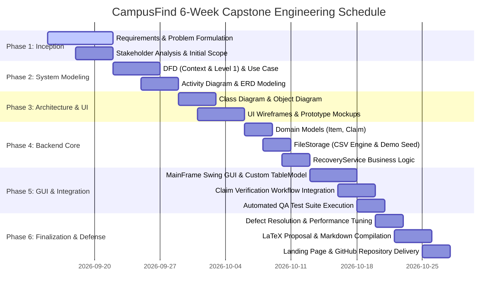

# Project Schedule, Milestones, Deliverables & Gantt Chart

This document outlines the proposed 6-week iterative engineering schedule for the **CampusFind** Capstone Project, aligning development phases, milestone exit criteria, and deliverables.

---

## 1. Six-Week Development Schedule

### Week-by-Week Visual Matrix
| Task / Phase | W1 | W2 | W3 | W4 | W5 | W6 | Responsible Entity | Deliverable Output |
| :--- | :---: | :---: | :---: | :---: | :---: | :---: | :--- | :--- |
| **Requirements & Scope Formulation** | `████` | | | | | | Requirements Analyst | Requirements Specification |
| **Data Flow (DFD) & Use Case Analysis** | | `████` | | | | | Software Designer | DFD (Level 0/1), Use Case Model |
| **Activity, ERD & Structural Modeling** | | `████` | `████` | | | | Data Modeler / Architect | Activity Diagram, ERD, Class Diagram |
| **UI Wireframing & Screen Layouts** | | | `████` | | | | UI Designer | UI Mockups, Object Diagram |
| **Core Java Backend (Models, Storage)** | | | | `████` | | | Java Developer | `Item`, `Claim`, `FileStorage` |
| **Service Logic & Verification Engine** | | | | `████` | | | Java Developer | `RecoveryService` (Logic, ID generator) |
| **Swing GUI (MainFrame, TableModel)** | | | | | `████` | | Front-End Developer | `MainFrame`, `ItemTableModel` |
| **QA Automated Testing & Validation** | | | | | `████` | | QA Tester | `CampusFindTestRunner` (10 tests) |
| **Documentation, LaTeX & Web Portal** | | | | | | `████` | Technical Writer | LaTeX Proposal, README, Website |
| **Repository Setup & Oral Defense Prep** | | | | | | `████` | Project Manager / Student | GitHub Repository, Viva Guide |

---

## 2. Project Milestones & Completion Conditions

| Milestone ID | Target Week | Milestone Name | Concrete Identifiable Completion Condition |
| :--- | :---: | :--- | :--- |
| **M1** | Week 1 | Proposal & Requirements Baselined | Signed-off project scope, functional/non-functional requirements, and stakeholder matrix approved by supervisor. |
| **M2** | Week 2 | System Architecture & Diagrams Baselined | Context DFD, Level 1 DFD, Use Case Diagram, Activity Diagram, and Logical ERD fully reviewed and verified. |
| **M3** | Week 3 | Structural Design & UI Prototype Ready | Class diagram, Object snapshot diagram, and Swing interface wireframe layouts finalized. |
| **M4** | Week 4 | Backend Java Implementation Complete | `Item`, `Claim`, `FileStorage`, and `RecoveryService` classes compiled and successfully performing CRUD operations. |
| **M5** | Week 5 | Full GUI & Claim Workflow Verified | Functional Swing prototype operational; automated test suite reports 10/10 tests PASS; private clues verified hidden. |
| **M6** | Week 6 | Final Submission Package Ready | Professional LaTeX/Markdown proposal generated; project landing page operational; GitHub repository configured. |

---

## 3. Deliverables Table

| Deliverable ID | Item Description | Format / Path | Associated Milestone |
| :--- | :--- | :--- | :---: |
| **DEL-01** | Formal Capstone Proposal Document | `proposal/proposal.tex` & `proposal/proposal.md` | M1, M6 |
| **DEL-02** | Complete UML & Software Diagram Suite | `proposal/diagrams/` (`.puml` and `.svg`) | M2, M3 |
| **DEL-03** | Interface Prototype Screenshots | `proposal/screenshots/` (`.svg`) | M3, M5 |
| **DEL-04** | Seven Java Source Classes | `src/campusfind/*.java` | M4, M5 |
| **DEL-05** | Pre-seeded Demonstration Data Files | `data/items.csv` & `data/claims.csv` | M4 |
| **DEL-06** | Automated SQA Verification Suite | `src/campusfind/CampusFindTestRunner.java` | M5 |
| **DEL-07** | Comprehensive Project Documentation | `docs/*.md` (Overview, Test Plan, Schedule, Viva) | M6 |
| **DEL-08** | GitHub Pages Project Landing Page | `website/index.html` & `website/style.css` | M6 |
| **DEL-09** | Authoritative GitHub Repository | `https://github.com/antor1112225/campusfind-java-se-capstone` | M6 |

---

## 4. Acceptance Criteria Table

| Requirement / Module | Formal Acceptance Criteria | Verification Method |
| :--- | :--- | :--- |
| **Item Reporting** | System accepts title, category, location, and contact. For "FOUND" items, accepts a confidential clue. Assigns unique sequential ID (`ITM-xxx`). | Execution of Automated Test TC-02 & TC-03 |
| **Information Hiding** | Table view displayed in public catalog strictly excludes `privateClue` column and values from row renders. | Automated inspection of `ItemTableModel` (TC-04) |
| **Claim Submission** | System accepts claimant name, contact, and ownership proof against valid OPEN found items. Rejects empty submissions. | Execution of Automated Test TC-06 & TC-07 |
| **Claim Verification** | Review panel displays founder's clue and claimant proof side-by-side. Allows one-click Accept or Reject with audit remarks. | Interactive UI testing & Test TC-08, TC-09 |
| **Auto-Resolution** | Accepting a claim automatically marks the item as RESOLVED and transitions competing pending claims to REJECTED. | Execution of Automated Test TC-09 |
| **Data Persistence** | Items and claims persist across application restarts in local CSV files without requiring an external database server. | Execution of Automated Test TC-10 |
| **Zero External Dependencies** | Application compiles and executes using standard Java SE libraries (Swing, java.io) without Spring or 3rd-party JARs. | Source code inspection & local compilation |
