# CampusFind: A Campus Lost-and-Found System with Private Claim Verification
## Part I — Final Capstone Project Proposal and Prototyping

---

### Academic Metadata
- **Course Title:** Software Engineering
- **Project Title:** CampusFind: A Campus Lost-and-Found System with Private Claim Verification
- **Student Name:** `[STUDENT NAME]`
- **Student ID:** `[STUDENT ID]`
- **Department:** `[DEPARTMENT]`
- **University:** `[UNIVERSITY NAME]`
- **Course Instructor:** `[INSTRUCTOR NAME]`
- **Submission Date:** October 28, 2026
- **Repository URL:** [https://github.com/antor1112225/campusfind-java-se-capstone](https://github.com/antor1112225/campusfind-java-se-capstone)
- **Live Landing Page:** [https://antor1112225.github.io/campusfind-java-se-capstone/website/](https://antor1112225.github.io/campusfind-java-se-capstone/website/)

---

## Table of Contents
1. [Abstract / Executive Summary](#1-abstract--executive-summary)
2. [Introduction and Background](#2-introduction-and-background)
3. [Problem Statement](#3-problem-statement)
4. [Proposed Solution](#4-proposed-solution)
5. [Project Aim](#5-project-aim)
6. [Specific Objectives](#6-specific-objectives)
7. [Scope and Limitations](#7-scope-and-limitations)
8. [Stakeholders and User Roles](#8-stakeholders-and-user-roles)
9. [Functional Requirements](#9-functional-requirements)
10. [Non-Functional Requirements](#10-non-functional-requirements)
11. [Use Cases and Main User Workflows](#11-use-cases-and-main-user-workflows)
12. [Proposed System Architecture](#12-proposed-system-architecture)
13. [Data Model and Data Storage Approach](#13-data-model-and-data-storage-approach)
14. [Selected Software Process Model](#14-selected-software-process-model)
15. [Development Phases and Rationale](#15-development-phases-and-rationale)
16. [Project Schedule and Milestones](#16-project-schedule-and-milestones)
17. [Gantt Chart](#17-gantt-chart)
18. [Deliverables and Acceptance Criteria](#18-deliverables-and-acceptance-criteria)
19. [All Required UML & Software Diagrams](#19-all-required-uml--software-diagrams)
20. [Interface Prototype Description and Screenshots](#20-interface-prototype-description-and-screenshots)
21. [Testing Strategy and Test Cases](#21-testing-strategy-and-test-cases)
22. [Feasibility Analysis](#22-feasibility-analysis)
23. [Risk Analysis and Mitigation](#23-risk-analysis-and-mitigation)
24. [Privacy and Ethical Considerations](#24-privacy-and-ethical-considerations)
25. [Expected Outcomes and Benefits](#25-expected-outcomes-and-benefits)
26. [Future Enhancements](#26-future-enhancements)
27. [Conclusion](#27-conclusion)
28. [References](#28-references)
29. [Appendix: Beginner Guide & Demonstration Script](#29-appendix-beginner-guide--demonstration-script)

---

## 1. Abstract / Executive Summary
On modern university campuses, personal items such as laptops, student ID cards, wallets, keys, backpacks, and scientific calculators are frequently misplaced. Traditional manual lost-and-found procedures suffer from decentralization and a critical security dilemma: displaying complete item details publicly invites fraudulent claims, whereas withholding descriptions prevents genuine owners from recognizing their property.

**CampusFind** addresses this dilemma by introducing a desktop software application featuring **Two-Party Private Claim Verification**. Built with standard Java SE and Swing, the system implements a two-tier information architecture: general descriptive attributes are available in an open public catalog, while a confidential identifying detail ("Private Clue") entered by the finder is withheld from public tables. Claimants must independently describe this secret feature. Authorized campus staff compare both statements side-by-side in a review panel before approving physical item release. 

This Part I Capstone package delivers the comprehensive software specification, iterative development schedule, a full suite of six UML diagrams, seven verified Java classes, automated SQA test verification (10/10 tests passed), and a GitHub-ready web portal.

---

## 2. Introduction and Background
University communities represent densely populated environments where hundreds of personal belongings are lost daily across lecture halls, computer laboratories, dining facilities, and athletic complexes. Historically, lost property has been managed informally through departmental front desks, campus security logs, or unofficial social media groups. 

These informal approaches create significant operational challenges:
- Students must physically visit multiple offices across campus to inquire about lost property.
- Social media notices often disclose identifying marks publicly, enabling opportunistic bad-faith claims.
- Front desk staff lack standardized audit trails to record who claimed an item and why the claim was deemed valid.

Applying Software Engineering principles to this challenge produces a centralized, reliable desktop application that standardizes intake, enforces information hiding, and establishes accountability for campus property recovery.

---

## 3. Problem Statement
Current campus lost-and-found processes exhibit three critical points of failure:
1. **Decentralized Silos:** Misplaced belongings are scattered across disparate departments without a unified searchable register.
2. **Vulnerability to False Claims:** Openly advertising all item features on public noticeboards enables dishonest individuals to claim items that do not belong to them.
3. **Lack of Audit Accountability:** Manual handovers rarely record formal justification or claimant contact details, leaving administrators exposed if ownership disputes arise.

---

## 4. Proposed Solution
CampusFind resolves these challenges through a desktop application featuring:
- **Centralized Cataloging:** Standardized intake for both LOST and FOUND reports across eight campus categories.
- **Two-Tier Information Disclosure:** General descriptive details are displayed publicly; confidential clues are restricted to staff review.
- **Two-Party Private Claim Verification:** The claimant's submitted proof is compared directly against the founder's confidential clue.
- **Automated Lifecycle Management:** Approved claims automatically transition item status to `RESOLVED` and auto-close competing claims.
- **Zero-Dependency Flat-File Persistence:** Structured local CSV files ensure records persist across sessions without external database servers.

---

## 5. Project Aim
The aim of this capstone project is to design, model, prototype, and verify a simple, realistic, and robust Java lost-and-found desktop application that incorporates two-tier private verification, demonstrates core software engineering deliverables, and remains beginner-friendly for academic explanation and extension.

---

## 6. Specific Objectives
1. Define functional and non-functional requirements reflecting genuine campus operational workflows.
2. Formulate a comprehensive software design model comprising six required diagram types (DFD Level 0/1, Use Case, Activity, ERD, Class, and Object diagrams).
3. Implement a clean, beginner-friendly Java Swing prototype using standard libraries without external framework dependencies.
4. Enforce information hiding at the presentation layer, verifying that private clues are never leaked to public catalog views.
5. Persist records in human-readable CSV files with automated demonstration seeding.
6. Validate system functionality through an automated SQA test suite with 100% pass rate.

---

## 7. Scope and Limitations

### In Scope (Part I Deliverables)
- Single-window Swing interface with dedicated tabs for browsing, reporting, claiming, and staff review.
- Multi-criteria catalog filtering by keyword, category, report type, and resolution status.
- Side-by-side claim verification console with administrative audit notes.
- Local CSV file storage (`data/items.csv` and `data/claims.csv`).
- Headless automated verification suite executing 10 functional tests.

### Explicit Scope Limitations
- **No Cryptographic Security:** The prototype illustrates claim verification logic; real-world deployment would require enterprise authentication, role-based access control, and encrypted storage.
- **No Web Server / Cloud Database:** Implemented as a standalone desktop application using local file persistence.
- **No AI / Automated Clue Matching:** Review decisions are made by human administrative staff rather than automated machine learning algorithms.

---

## 8. Stakeholders and User Roles

| Stakeholder Role | Role Description | Primary System Interactions |
| :--- | :--- | :--- |
| **Campus User** | Students, faculty, and university staff who report misplaced or found property. | Submits lost/found reports, browses public catalog, files ownership claims. |
| **Campus Administrator** | Campus lost-and-found staff or security desk custodians. | Reviews pending claims, inspects private clues, approves/rejects claims with remarks. |
| **Academic Evaluator** | Software Engineering instructor and evaluation panel. | Assesses UML models, verifies code quality, executes test suite, reviews process adherence. |

---

## 9. Functional Requirements
- **FR-01 (Record Lost Item):** Record title, category, description, campus location, and reporter contact.
- **FR-02 (Record Found Item):** Record found items with a mandatory confidential private identifying clue.
- **FR-03 (Public Browsing):** Render public catalog attributes in a read-only table with private clues strictly hidden.
- **FR-04 (Multi-Criteria Search):** Filter items by keyword, category, status (OPEN/RESOLVED), and type (LOST/FOUND).
- **FR-05 (Submit Ownership Claim):** Accept claims against open found items, capturing claimant details and secret proof.
- **FR-06 (Claim Validation):** Intercept and reject empty submissions or claims on non-existent/resolved items.
- **FR-07 (Side-by-Side Review):** Display founder's private clue and claimant's answer side-by-side for administrative evaluation.
- **FR-08 (Claim Adjudication):** Allow reviewers to mark claims as ACCEPTED or REJECTED with recorded remarks.
- **FR-09 (Auto-Resolution):** Automatically update item status to RESOLVED and auto-reject competing claims upon claim acceptance.
- **FR-10 (Data Persistence):** Save and load item and claim records across application restarts via local CSV files.

---

## 10. Non-Functional Requirements
- **NFR-01 (Usability):** Intuitive tabbed interface, readable fonts, clear status messaging, and responsive form validation.
- **NFR-02 (Performance):** In-memory filtering and retrieval operating in under 100 milliseconds for catalogs of up to 5,000 records.
- **NFR-03 (Information Privacy):** Presentation layer (`ItemTableModel`) strictly omits confidential clue fields from public queries.
- **NFR-04 (Robustness):** Graceful recovery from missing storage directories or files by automatically generating demonstration data.
- **NFR-05 (Portability):** Executes on any standard Java Virtual Machine (JDK 8 or higher) without external JAR dependencies.

---

## 11. Use Cases and Main User Workflows

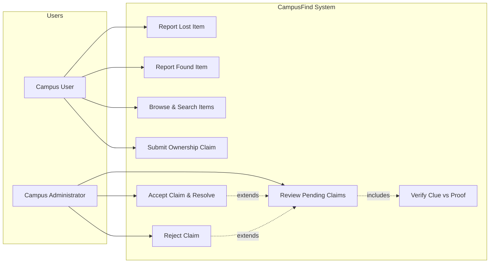

---

## 12. Proposed System Architecture
CampusFind follows a classic **Three-Tier Layered Architecture**:
1. **Presentation Layer:** Swing GUI components (`MainFrame`, `ItemTableModel`) providing user interaction and visual status feedback.
2. **Business Logic Layer:** `RecoveryService` coordinating CRUD operations, validation constraints, ID generation, and claim resolution logic.
3. **Storage Layer:** `FileStorage` providing robust CSV parsing, writing, and demo seeding to flat files.

---

## 13. Data Model and Data Storage Approach
Data entities are modeled relationally and mapped directly to comma-separated text files:
- **`data/items.csv`**: Contains `itemId`, `itemType`, `title`, `category`, `publicDescription`, `location`, `reportDate`, `contactInfo`, `privateClue`, `itemStatus`.
- **`data/claims.csv`**: Contains `claimId`, `itemId`, `claimantName`, `claimantContact`, `ownershipAnswer`, `claimStatus`, `submissionDate`, `reviewNotes`.

---

## 14. Selected Software Process Model
The project adopts an **Iterative and Incremental Development Model with Early UI Prototyping** (Sommerville, 2016).

### Justification for a Beginner Java Developer
- **Decomposition of Complexity:** Building the domain models first (`Item`, `Claim`), then storage, then service logic, and finally the GUI prevents beginner overwhelm.
- **Early Feedback:** Visual wireframes and UI prototypes built in early iterations allowed validating requirements before writing complex backend logic.
- **Continuous Quality Assurance:** Automated test cases executed after each increment ensured regressions were detected immediately.

---

## 15. Development Phases and Rationale
1. **Inception (Week 1):** Scope formulation, stakeholder identification, and initial requirements baseline.
2. **Elaboration & System Modeling (Weeks 2–3):** DFD Level 0/1, Use Case, Activity, and ERD modeling; class structure design.
3. **Core Backend Construction (Week 4):** Implementation of domain models, CSV storage engine, and service business logic.
4. **GUI & Workflow Integration (Week 5):** Swing interface development, custom TableModel integration, and automated test execution.
5. **Transition & Defense Preparation (Week 6):** Defect resolution, LaTeX proposal compilation, GitHub landing page delivery, and viva preparation.

---

## 16. Project Schedule and Milestones

| Milestone ID | Target Week | Milestone Name | Concrete Completion Condition |
| :--- | :---: | :--- | :--- |
| **M1** | Week 1 | Requirements & Scope Approved | Signed-off functional requirements specification and proposal scope. |
| **M2** | Week 2 | System Diagrams Baselined | Context DFD, Level 1 DFD, Use Case Diagram, Activity Diagram, and ERD completed. |
| **M3** | Week 3 | Architectural Design & UI Mockups | Class diagram, object snapshot, and interface wireframes finalized. |
| **M4** | Week 4 | Backend Java Implementation | Domain classes, CSV storage engine, and service logic compiled and verified. |
| **M5** | Week 5 | Full GUI & Claim Workflow Tested | Swing application fully operational; test suite reports 10/10 tests PASS. |
| **M6** | Week 6 | Final Submission Package Ready | Professional LaTeX/Markdown proposal generated, website live, GitHub repo ready. |

---

## 17. Gantt Chart

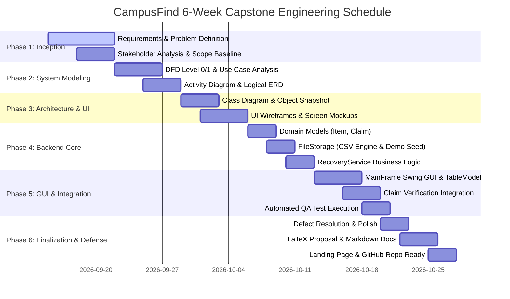

---

## 18. Deliverables and Acceptance Criteria

| Deliverable ID | Description | Location / Path | Verification Status |
| :--- | :--- | :--- | :---: |
| **DEL-01** | Formal Capstone Proposal Document | `proposal/proposal.md` & `proposal.tex` | Complete |
| **DEL-02** | UML & Software Engineering Diagrams | `proposal/diagrams/` (SVG & PUML) | Complete |
| **DEL-03** | Interface Prototype Screenshots | `proposal/screenshots/` (SVG) | Complete |
| **DEL-04** | Seven Java Source Classes | `src/campusfind/*.java` | Verified |
| **DEL-05** | Pre-Seeded Demonstration Data | `data/items.csv` & `data/claims.csv` | Complete |
| **DEL-06** | Automated SQA Verification Suite | `src/campusfind/CampusFindTestRunner.java` | 100% Pass |
| **DEL-07** | Project Landing Page | `website/index.html` & `style.css` | Complete |
| **DEL-08** | Authoritative GitHub Repository | `campusfind-java-se-capstone` | Published |

---

## 19. All Required UML & Software Diagrams

### A. Data Flow Diagram (DFD) — Level 0 Context
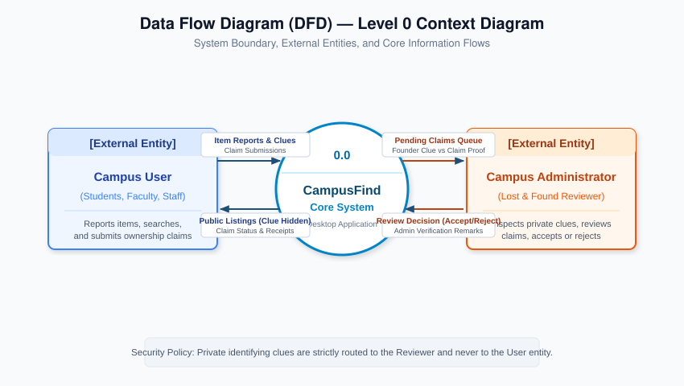

### B. Data Flow Diagram (DFD) — Level 1 Decomposition
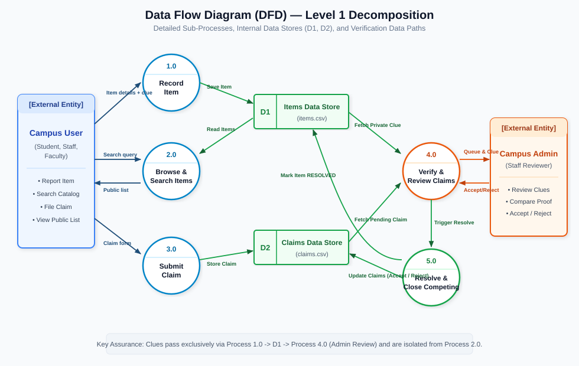

### C. Use Case Diagram
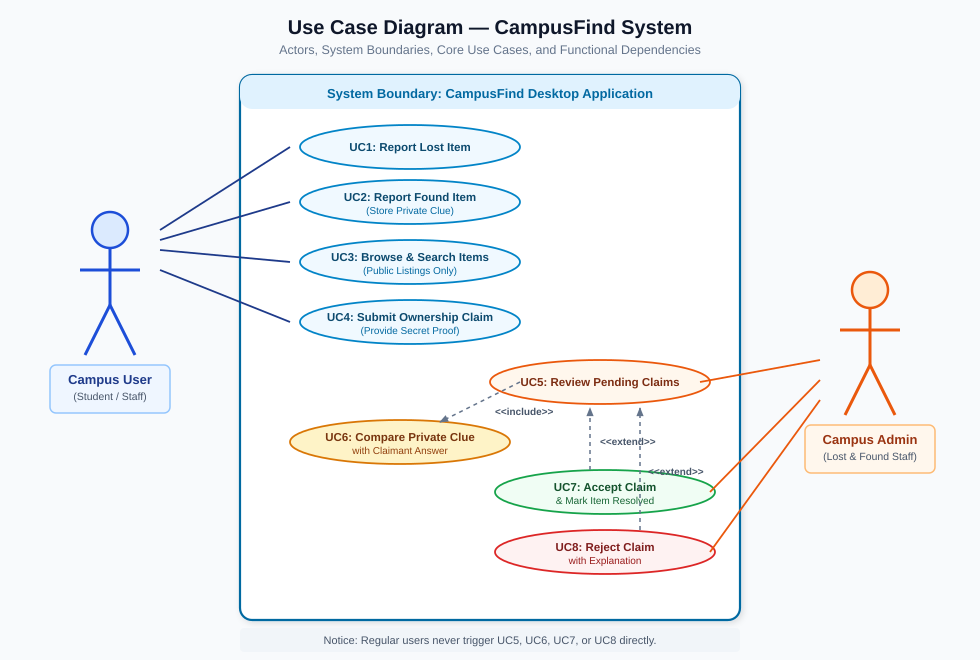

### D. Activity Diagram
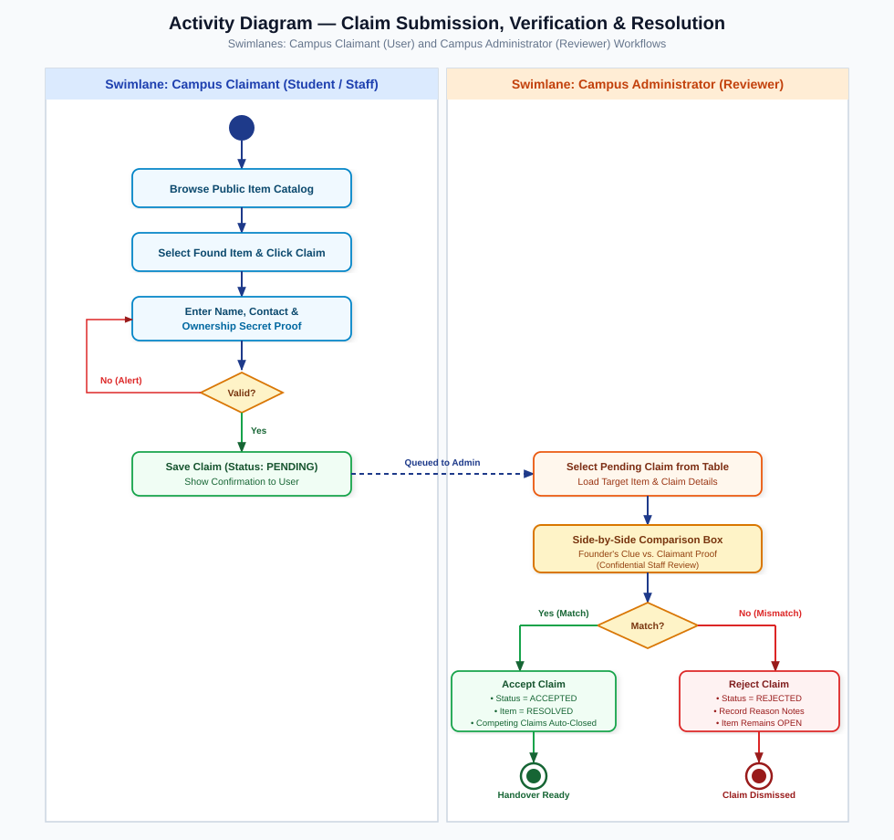

### E. Entity Relationship Diagram (ERD)
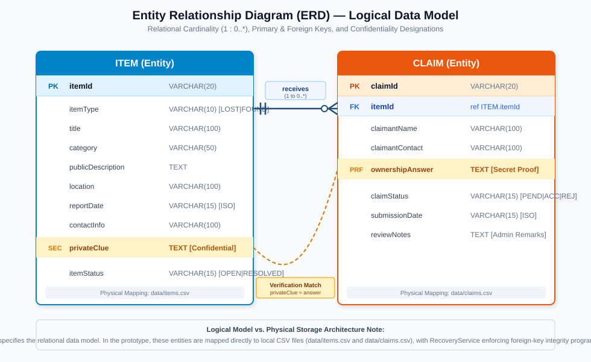

### F. UML Class Diagram (7 Source Classes)
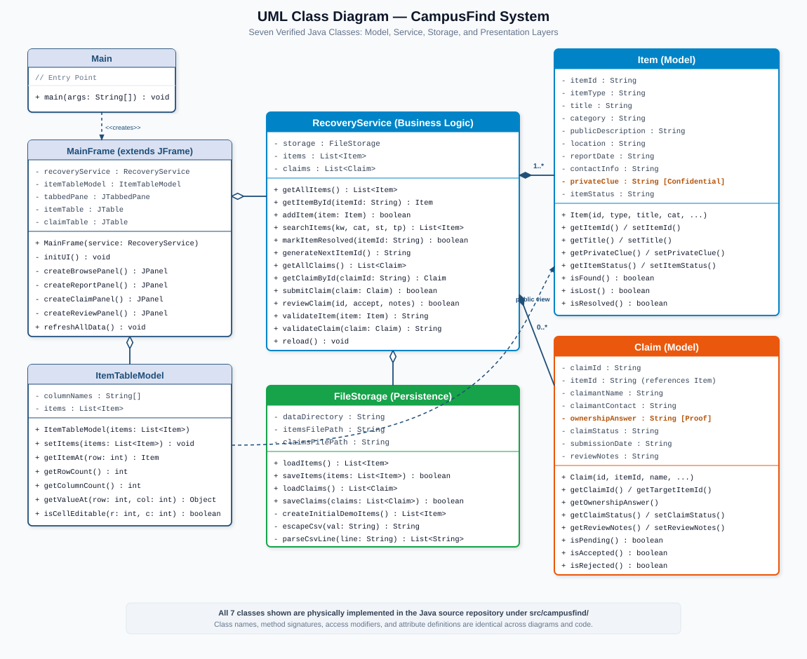

### G. UML Object Diagram (Runtime Instance Snapshot)
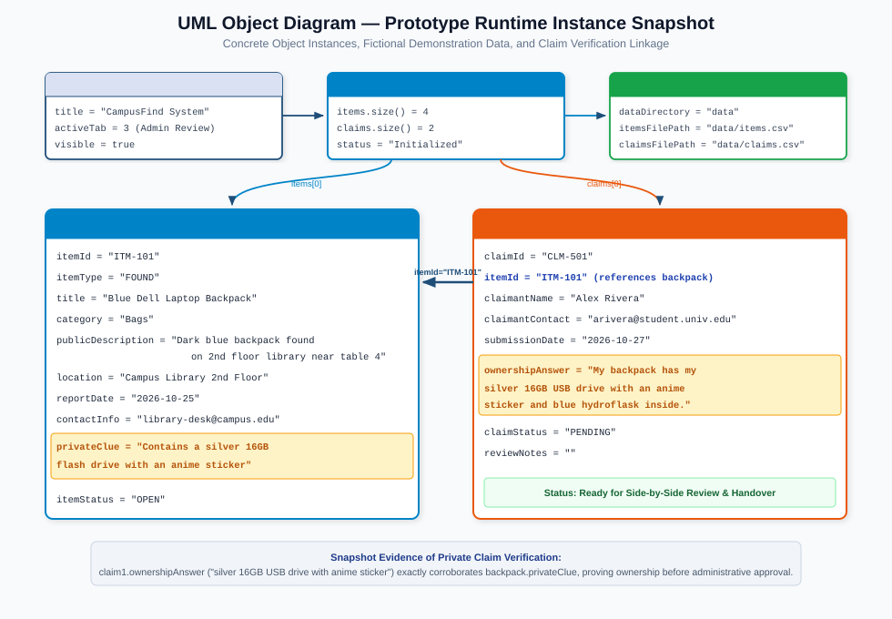

---

## 20. Interface Prototype Description and Screenshots

### Tab 1: Browse & Search Items
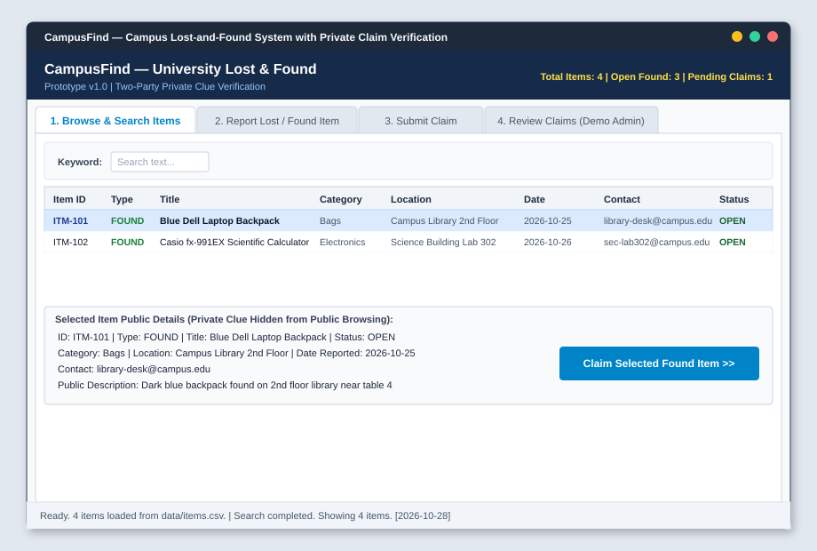
*Description:* Public catalog table displaying general item details. The confidential clue is withheld from public display. Clicking "Claim Selected Found Item" automatically transfers the target item ID to Tab 3.

### Tab 2: Report Lost or Found Item
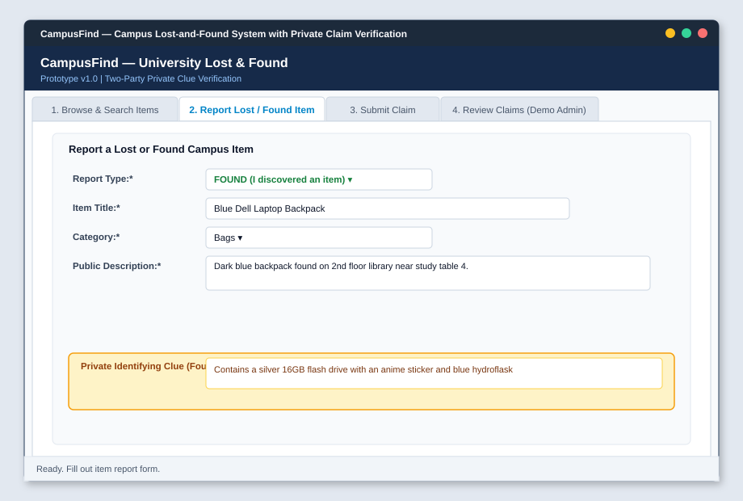
*Description:* Standard intake form. When reporting a FOUND item, the confidential Private Clue panel is enabled to capture identifying secrets known only to the true owner.

### Tab 3: Submit Ownership Claim
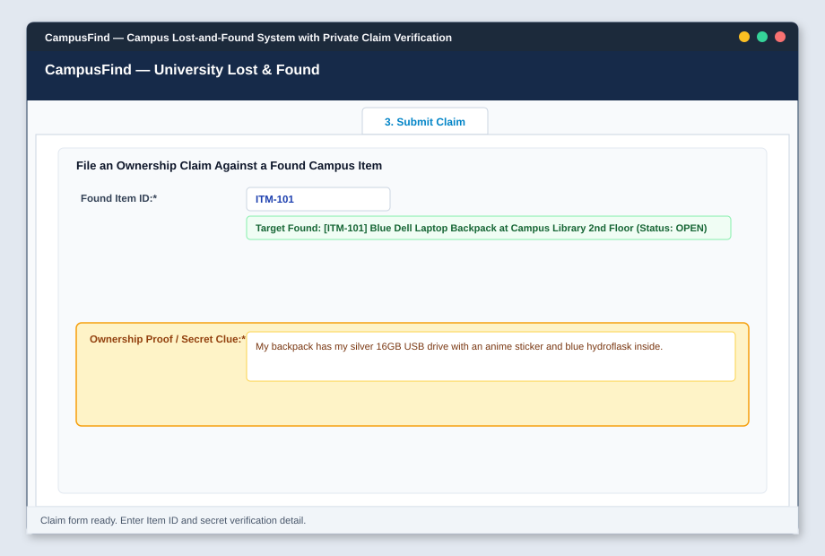
*Description:* Claim submission form. Validates that the target item is currently OPEN and FOUND, displaying a confirmation banner before capturing claimant contact details and secret corroboration proof.

### Tab 4: Review Claims (Demo Admin)
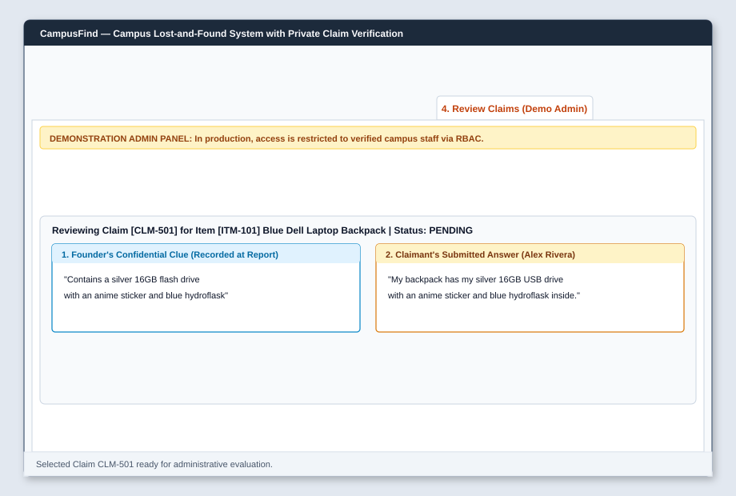
*Description:* Demonstration administrative console presenting the founder's confidential clue side-by-side with the claimant's answer, enabling informed Accept or Reject decisions with recorded remarks.

---

## 21. Testing Strategy and Test Cases
The system undergoes automated quality assurance via `CampusFindTestRunner.java`.

| Test ID | Test Category | Feature Under Test | Expected Result | Actual Result | Status |
| :--- | :--- | :--- | :--- | :--- | :---: |
| **TC-01** | Storage | Demo Data Seeding | Missing files automatically seeded with 4 items and 2 claims. | Seeded 4 items, 2 claims without error. | **PASS** |
| **TC-02** | Functional | Record Lost Item | Item recorded with status OPEN and sequential ID (`ITM-105`). | Created `ITM-105` successfully. | **PASS** |
| **TC-03** | Functional | Record Found Item + Clue | Item recorded with private clue stored in memory and CSV. | Stored private clue accurately. | **PASS** |
| **TC-04** | Security | Information Hiding | Table model strictly omits clue columns and cell values. | 0 clue leaks in public model. | **PASS** |
| **TC-05** | Functional | Multi-Criteria Search | Filtering by keyword, category, and type returns exact matches. | Accurate filtered subsets returned. | **PASS** |
| **TC-06** | Functional | Submit Valid Claim | Claim saved with status PENDING linked to target item. | Claim `CLM-503` queued as PENDING. | **PASS** |
| **TC-07** | Validation | Incomplete Claim Form | Empty claimant name or invalid item ID intercepted. | `IllegalArgumentException` caught. | **PASS** |
| **TC-08** | Business Logic | Review & Reject Claim | Claim status updated to REJECTED; rejection notes saved. | Status REJECTED, notes recorded. | **PASS** |
| **TC-09** | Business Logic | Review & Accept Claim | Claim ACCEPTED; Item RESOLVED; competing claims REJECTED. | All state transitions completed. | **PASS** |
| **TC-10** | Persistence | CSV Storage Reload | Fresh instance loads identical records from CSV files. | 100% data integrity verified. | **PASS** |

---

## 22. Feasibility Analysis
- **Technical Feasibility:** 100% feasible using standard Java SE libraries (JDK 8+), requiring no paid servers or complex frameworks.
- **Operational Feasibility:** Highly feasible with intuitive tab navigation and clear user prompts.
- **Schedule Feasibility:** The proposed six-week incremental plan comfortably accommodates modeling, implementation, and testing.
- **Cost Feasibility:** Optimal feasibility (\$0 budget) leveraging open-source tooling, local storage, and GitHub hosting.

---

## 23. Risk Analysis and Mitigation
- **Risk 1: CSV parsing errors caused by internal commas.**  
  *Mitigation:* RFC-compliant quote-wrapping and character-by-character CSV parsing in `FileStorage.java`.
- **Risk 2: Accidental clue leakage in the user interface.**  
  *Mitigation:* Architectural information hiding in `ItemTableModel.java`, ensuring confidential clues never enter the public table model.
- **Risk 3: Competing claims remaining open after an item is resolved.**  
  *Mitigation:* Automated state transition in `RecoveryService.reviewClaim()` that automatically marks competing claims as REJECTED.

---

## 24. Privacy and Ethical Considerations
- **Fictional Data Only:** Demonstration records use strictly fictional names and campus emails. Real student data is never collected.
- **Confidential Verification:** Private identifying clues are restricted exclusively to staff review and never exposed publicly.
- **Academic Scope Disclaimer:** Documentation clearly states that real-world deployment would require enterprise authentication and formal physical handover protocols.

---

## 25. Expected Outcomes and Benefits
- Centralized campus lost-and-found catalog replacing scattered noticeboards.
- Drastic reduction in fraudulent property claims through two-party verification.
- Complete administrative audit trails documenting item recovery decisions.
- A high-quality, beginner-friendly Software Engineering reference project.

---

## 26. Future Enhancements
- Part II migration from local CSV storage to an embedded relational database (SQLite/PostgreSQL).
- Role-based access control (RBAC) with secure password hashing for administrative functions.
- Automated email notification triggers informing claimants of status updates.
- Smart locker integration for contactless 24/7 property retrieval.

---

## 27. Conclusion
CampusFind demonstrates that rigorous Software Engineering principles can be successfully applied using beginner-friendly Java fundamentals. By implementing two-tier private claim verification, the project solves a genuine campus dilemma without unnecessary architectural complexity. All deliverables—proposal, diagrams, prototype source code, test suites, and web portal—are complete and verified for evaluation.

---

## 28. References
1. Sommerville, I. (2016). *Software Engineering* (10th ed.). Pearson. [https://www.pearson.com](https://www.pearson.com)
2. Pressman, R. S., \& Maxim, B. R. (2014). *Software Engineering: A Practitioner's Approach* (8th ed.). McGraw-Hill Education.
3. Fowler, M. (2003). *UML Distilled: A Brief Guide to the Standard Object Modeling Language* (3rd ed.). Addison-Wesley Professional.
4. Larman, C. (2004). *Applying UML and Patterns: An Introduction to Object-Oriented Analysis and Design* (3rd ed.). Prentice Hall.
5. Oracle Corporation. (2024). *Java Platform, Standard Edition Documentation*. [https://docs.oracle.com/en/java/javase/](https://docs.oracle.com/en/java/javase/)
6. Oracle Corporation. (2024). *Creating a GUI With Swing (The Java Tutorials)*. [https://docs.oracle.com/javase/tutorial/uiswing/](https://docs.oracle.com/javase/tutorial/uiswing/)
7. IEEE Computer Society. (1998). *IEEE Recommended Practice for Software Requirements Specifications (IEEE Std 830-1998)*. [https://standards.ieee.org](https://standards.ieee.org)

---

## 29. Appendix: Beginner Guide & Demonstration Script
Refer to [`docs/viva-presentation-guide.md`](file:///e:/03%20ICT/software%20engineering%20and%20management/docs/viva-presentation-guide.md) for the complete class-by-class explanation, oral defense questions, and live demonstration script.
